# Synapse // Enterprise Hybrid Search & Document Intelligence Engine

[](https://www.python.org/downloads/)
[](https://fastapi.tiangolo.com/)
[](https://github.com/pgvector/pgvector)
[](https://redis.io/)
[](https://github.com/explodinggradients/ragas)
[](https://opensource.org/licenses/Apache-2.0)

> A production-grade Retrieval-Augmented Generation (RAG) platform engineered for complex enterprise documents (financial statements, kernel advisories, architectural specifications). Replaces naive vector search with **Dense + BM25 Hybrid Retrieval**, **Reciprocal Rank Fusion (RRF)**, **Cross-Encoder Re-Ranking**, **Redis Semantic Caching**, and **Exact Citation Grounding**.

---

## 60-Second Video Walkthrough

[](https://www.loom.com)

*Click above for a 60-second architecture and live retrieval demonstration.*

---

## System Architecture

```mermaid
flowchart TD
    subgraph Ingestion["1. Layout-Aware Ingestion Pipeline"]
        DOC["PDF / Markdown / Tables"] --> CHUNKER["Contextual & Hierarchical Chunker"]
        CHUNKER --> DENSE_EMB["Dense Embedder (text-embedding-004)"]
        CHUNKER --> BM25_IDX["BM25Okapi Inverted Index"]
        DENSE_EMB --> PG["PostgreSQL (pgvector HNSW)"]
        BM25_IDX --> PG
    end

    subgraph QueryExecution["2. Query Execution & Dual Retrieval"]
        QUERY["User Search Query"] --> CACHE{"Redis Semantic Cache"}
        CACHE -- "Hit (Cosine Sim >= 0.95)" --> FAST["Cached Response (<25ms, $0.00 Cost)"]
        
        CACHE -- "Cache Miss" --> DUAL["Dual Retrieval: Dense (ANN) + BM25Okapi"]
        DUAL --> RRF["Reciprocal Rank Fusion (RRF Top 30)"]
        RRF --> RERANK["Cross-Encoder Re-Ranker (BGE-Reranker)"]
        RERANK --> TOPK["Top 5 High-Precision Chunks"]
        TOPK --> SYNTH["Grounded LLM Synthesizer (Pydantic Schema)"]
        SYNTH --> OUT["Final Answer with Clickable Citations [1], [2]"]
        SYNTH --> CACHE_SET["Update Redis Semantic Cache"]
    end
```



---

## Why Hybrid Search Beats Naive Vector Search

| Retrieval Modality | Strengths | Failure Mode in Enterprise |
| :--- | :--- | :--- |
| **Dense Embeddings Only** | Semantic intent, conceptual synonyms | Fails completely on exact error codes (`ERR_401`), CVE IDs (`CVE-2024-8192`), memory offsets (`0x7fff90a4`), and specific part numbers. |
| **BM25 Keyword Only** | Exact token and acronym matching | Fails when users formulate conceptual or semantic questions without matching exact document vocabulary. |
| **Synapse Hybrid (Dense + BM25 + RRF + Re-Rank)** | High recall across exact tokens **and** conceptual semantics; cross-encoders filter out retrieval noise. | **Solves both:** Achieves **85.7% Context Precision** and **100% Context Recall** on enterprise benchmarks. |

### Mathematical Grounding: Reciprocal Rank Fusion (RRF)
Candidates from dense vector search and BM25 sparse search are fused using:

$$\text{RRF\_Score}(d) = \sum_{m \in \{\text{dense}, \text{bm25}\}} \frac{1}{k + r_m(d)}$$

Where $k = 60$ is the smoothing constant that balances top ranks across disparate modalities.

---

## Empirical Benchmark Matrix (Ragas Evaluation)

Tested against 10 gold-standard enterprise queries across Linux Kernel Advisories, Multi-Page Financial Reports, and Raft Distributed Consensus Specifications:

| Architecture | Context Precision | Context Recall | Faithfulness | Answer Relevance |
| :--- | :---: | :---: | :---: | :---: |
| **Dense Only** | 55.0% | 65.0% | 100.0% | 62.0% |
| **BM25 Only** | 25.0% | 30.0% | 100.0% | 44.0% |
| **Hybrid (RRF)** | 56.7% | 75.0% | 100.0% | 78.0% |
| **Hybrid + Cross-Encoder Re-Rank (Synapse)** | **85.7%** | **100.0%** | **100.0%** | **84.7%** |

---

## Redis Semantic Caching (<25ms, $0.00 Cost)

Incoming queries are embedded and compared against cached queries using vector cosine similarity:

$$\text{Cosine\_Similarity}(\mathbf{u}, \mathbf{v}) = \frac{\mathbf{u} \cdot \mathbf{v}}{\|\mathbf{u}\|_2 \|\mathbf{v}\|_2} \ge 0.95$$

* **Cache Hits:** Return verified answers in **<25ms** with **0 tokens consumed and $0.00 API cost**.
* **Cost Savings:** Slashes production LLM API operational costs by up to **60%** for repetitive enterprise queries.

---

## Quickstart

### 1. Local Run (Zero-Drain Offline Engine)
```bash
# Clone the repository
git clone https://github.com/keshav647/enterprise-hybrid-rag.git
cd enterprise-hybrid-rag

# Create virtual environment and install dependencies
python3 -m venv .venv
source .venv/bin/activate
pip install -r requirements.txt

# Run the test suite (19/19 passing)
python -m pytest tests -v

# Start the interactive web UI and API
python -m src.api.server
```
Navigate to `http://localhost:8000` to access the interactive web interface, or `http://localhost:8000/docs` for Swagger UI.

### 2. CLI Execution
```bash
# Execute a hybrid query directly
python -m src.cli query "What is the memory offset of CVE-2024-8192?"

# Run the live Ragas evaluation benchmark
python -m src.cli evals
```

### 3. Single-Command Docker Deployment
```bash
docker compose up -d
```
Spins up:
1. `synapse_pgvector_db` (PostgreSQL 16 with native `pgvector` & HNSW indexing)
2. `synapse_redis_cache` (Redis 7 for semantic query caching)
3. `synapse_rag_engine` (FastAPI backend and responsive obsidian dark UI)

---

## API Reference

* `POST /api/v1/search`: Executes hybrid retrieval, re-ranking, semantic caching, and grounded synthesis.
* `POST /api/v1/search/raw`: Returns detailed multi-stage telemetry (Dense, BM25, RRF, Re-rank candidates).
* `GET /api/v1/documents`: Lists all indexed documents, total chunks, and tags.
* `GET /api/v1/documents/{doc_id}`: Returns document metadata and parsed chunk contents.
* `GET /api/v1/cache/stats`: Telemetry on cache hits, misses, hit ratio, and dollar savings.
* `POST /api/v1/cache/clear`: Clears the Redis semantic cache.
* `GET /api/v1/benchmarks`: Pre-computed Ragas evaluation matrix and comparison tables.
* `GET /api/v1/health`: Health status, indexed chunk count, and provider info.

---

## License
Apache-2.0. Built by Keshav Budhiraja.
