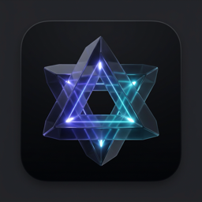

<div align="center">
  

  # Synapse // Enterprise Hybrid Search & Document Intelligence Engine

  [-10b981.svg)](#)
  [](https://www.python.org/downloads/)
  [](https://fastapi.tiangolo.com/)
  [](https://github.com/pgvector/pgvector)
  [-DC382D.svg)](https://redis.io/)
  [](https://github.com/explodinggradients/ragas)
  [](https://opensource.org/licenses/Apache-2.0)
  [](https://www.loom.com/share/0fb293b4fb314d2aa3f7c1bc6f9215e3)
  [](https://github.com/keshav647)
</div>

> A production-grade Retrieval-Augmented Generation (RAG) platform engineered for high-stakes enterprise documents across **6 domains (42 contextual chunks)**: Linux Kernel Security Advisories (`CVE-2024-8192`), SEC Q3 10-Q Financial Statements, Distributed Raft Consensus RFCs, Legal GDPR & MSA SLAs, FDA Phase III Oncology Clinical Trial Protocols (`NCT-09482110`), and SRE SEV-1 Incident Post-Mortems (`INC-2024-1004`). Replaces naive vector search with **768-D Dense + BM25 Okapi Hybrid Retrieval**, **Reciprocal Rank Fusion (RRF, $k=60$)**, **Cross-Encoder Re-Ranking**, **Redis Semantic Caching ($\text{Cosine} \ge 0.95$, $<25\text{ms}$)**, **Live Custom Document Ingestion**, and **Exact Citation Grounding (`[1]`, `[2]`)** across a **7-Page Three.js WebGL & Double-Bezel UI Architecture**.

---

## 🎬 Architecture Tour & Live Video Walkthrough

> **Watch the full 1080p architecture tour and live 7-page system demonstration on Loom:**  
> [](https://www.loom.com/share/0fb293b4fb314d2aa3f7c1bc6f9215e3)  
> *Direct Link:* [https://www.loom.com/share/0fb293b4fb314d2aa3f7c1bc6f9215e3](https://www.loom.com/share/0fb293b4fb314d2aa3f7c1bc6f9215e3)  
> *For the step-by-step evaluation guide and reviewer checklist, see [Technical Walkthrough & Evaluation Guide](docs/WALKTHROUGH.md).*

---

## System Architecture

```mermaid
flowchart TD
    subgraph Ingestion["1. Layout-Aware & Live Custom Ingestion Pipeline"]
        DOC["6 Enterprise Domains + Custom .MD/.TXT/.JSON Upload"] --> CHUNKER["Contextual & Hierarchical Chunker ([Document | Section | Page])"]
        CHUNKER --> DENSE_EMB["768-D Dense Embedder (text-embedding-004)"]
        CHUNKER --> BM25_IDX["BM25Okapi Inverted Index (k1=1.5, b=0.75)"]
        DENSE_EMB --> PG["PostgreSQL 16 (pgvector HNSW) / In-Memory Store"]
        BM25_IDX --> PG
    end

    subgraph QueryExecution["2. 4-Stage Query Execution & Dual Retrieval"]
        QUERY["User Search Query (Global or Domain-Scoped)"] --> CACHE{"Redis / In-Memory Semantic Cache"}
        CACHE -- "Hit (Cosine Sim >= 0.95 or SHA-256)" --> FAST["Cached Grounded Response (<25ms, $0.00 Cost)"]
        
        CACHE -- "Cache Miss" --> DUAL["Stage 1: Dual Recall (768-D Dense ANN + BM25Okapi)"]
        DUAL --> RRF["Stage 2: Reciprocal Rank Fusion (RRF k=60, Top 30)"]
        RRF --> RERANK["Stage 3: Cross-Encoder Neural Re-Ranker"]
        RERANK --> TOPK["Top-K High-Precision Grounding Chunks (Default K=5)"]
        TOPK --> SYNTH["Stage 4: Multi-Provider LLM Synthesizer (Pydantic Citations)"]
        SYNTH --> OUT["Final Answer with Clickable Citations [1], [2] & Source Lock"]
        SYNTH --> CACHE_SET["Update Semantic Cache"]
    end
```



---

## 7-Page Three.js WebGL & Double-Bezel UI Architecture

Synapse features a bespoke **Double-Bezel (`26px` squircle)** dark carbon interface (`#070709` / `#101016`) with a **Floating "Fluid Island" 7-Page Pill Navbar**, **Three.js WebGL GLSL Simplex Noise & Fresnel Refraction Spheres** (with live `Indigo`, `Cyan`, and `Coral` shader themes), and typography pairing **`Syne` / `Outfit` / `Space Grotesk`** (Display), **`Plus Jakarta Sans`** (Body), and **`Space Mono` / `JetBrains Mono`** (Code & Tabular Telemetry):

| Page | Route | Template Signature | Core Capabilities |
| :--- | :--- | :--- | :--- |
| **01 // Overview** | `/` or `/overview` | `THREEUI // VANGUARD-DIMENSIONAL` | Fullscreen GLSL Simplex Noise + 4 floating Fresnel glass spheres, live 4-pillar telemetry HUD, instant query dispatcher, and 6-Domain Launchpad. |
| **02 // Search** | `/search` | `THREEUI // DIAGNOSTICS-LASER` | Primary Hybrid RAG Workbench: 6-Domain selector ribbon, Quick Ingest Modal (`+ Upload / Paste Doc`), 3-mode toggle (`Smart Hybrid`, `Dense 768-D`, `BM25 Okapi`), `<25ms` Cache Hit tester, split-screen Grounded Synthesis with clickable `[1]` citations, and sticky Right-Hand Live Source Inspector. |
| **03 // Pipeline** | `/pipeline` | `THREEUI // ISOMETRIC-DAG` | 3D Isometric Canvas visualizers (`#canvas-layers`, `#canvas-nodes`, `#canvas-flow`), simultaneous **3-Mode Side-by-Side Ablation** (`Smart Hybrid` vs `Dense Only` vs `BM25 Only`), and Mathematical Candidate Fusion Trace table. |
| **04 // Corpus** | `/documents` | `THREEUI // VOID-PROTOCOL` | Machined hardware document reader with search filter, section & chunk jump outline, and toggle between **Contextual Chunks View** (with injected `[Document | Section]` preamble headers) and **Full Markdown Reader**. |
| **05 // Ingest** | `/ingest` | `THREEUI // MATRIX-FIELD` | Interactive WebGL Lightning Shader studio: 4 1-click enterprise sample templates (Istio mTLS, Series C SaaS ARR, Kafka Tiered S3, HIPAA BAA), `.md/.txt/.json` drag-and-drop upload, live `## Section` chunk preview, and instant indexing into Dense + BM25 stores. |
| **06 // Benchmarks** | `/analytics` | `THREEUI // PERFORMANCE-GAUGES` | 4 brushed-metal physical instrument dials (`Precision@5`, `Recall@10`, `MRR`, `NDCG@5`), 4-mode ablation comparison matrix, and interactive **13-Query Live Benchmark Suite** across all 6 domains. |
| **07 // Gateway** | `/settings` | `THREEUI // GATEWAY-FLOW` | Interactive Bezier particle convergence stream with radial click shockwaves, **BYOK Multi-Provider AI Vault** (`Gemini`, `OpenAI`, `Anthropic Claude`, `Groq` with prefix auto-detection & live `/api/v1/auth/test_key` handshake), Top-K slider, and Semantic Cache Control Console. |

---

## Pre-Loaded 6-Domain Enterprise Corpus (42 Contextual Chunks)

At startup, `AppState.bootstrap_default_documents()` automatically parses, chunks, embeds, and indexes **6 realistic enterprise documents** (plus 4 interactive paste templates in the Ingest Studio):

| Domain ID | Document ID | Title & Enterprise Scope | Key Ground-Truth Identifiers & Metrics |
| :--- | :--- | :--- | :--- |
| **01 // Security** | `cve_2024_8192_kernel_security_advisory` | **CVE-2024-8192: Linux Kernel Netfilter / Packet Ring Privilege Escalation** | CVSS 9.8, offset `0x7fff90a4` in `packet_set_ring` (`af_packet.c`), Git patch `a7f8e910c2d3`, `sysctl kernel.bpf_jit_harden=2`. |
| **02 // Financial** | `q3_enterprise_cloud_infrastructure_financials` | **Q3 Enterprise Cloud Infrastructure Financial Report (Form 10-Q)** | `$14.82B` total revenue, `32.4%` operating margin, `+84.0%` YoY AI Cloud growth (`$2.70B`), `$3.41B` CAPEX (`48,000` NVIDIA H100/B200 GPUs). |
| **03 // Architecture** | `distributed_raft_consensus_architecture_spec` | **Distributed Raft Consensus & Linearizable State Machine Spec (RFC-804)** | `50ms` `AppendEntries` heartbeat, `150ms–300ms` election timeout, `50,000` entries / `2.5 GB` snapshot trigger, `200ms` Leader Lease reads. |
| **04 // Compliance** | `enterprise_msa_gdpr_compliance_sla` | **Enterprise Master Services Agreement (MSA) & GDPR Data Processing SLA** | `99.99%` uptime SLA (`25%` credit at `99.50%`), `14-hour` GDPR Art. 33 breach notification window, `$15,000,000` super-cap liability. |
| **05 // Biomedical** | `fda_phase3_oncology_clinical_protocol` | **FDA Phase III Oncology Clinical Trial Protocol (NCT-09482110)** | Cohort A mPFS `14.8 months` vs `8.2 months` (`HR = 0.54`, $p = 0.00018$), `68.4%` ORR, CTCAE v5.0 Grade 3/4 pneumonitis rules. |
| **06 // Incident** | `sev1_global_payment_gateway_postmortem` | **Incident Post-Mortem INC-2024-1004: Global Payment Gateway SEV-1 Outage** | `47-minute` outage from PgBouncer `4,096` connection pool exhaustion, `kubectl rollout undo deployment/payment-router-v4` mitigation. |

---

## Why Hybrid Search Beats Naive Vector Search

| Retrieval Modality | Strengths | Failure Mode in Enterprise |
| :--- | :--- | :--- |
| **Dense Embeddings Only (768-D)** | Semantic intent, conceptual synonyms | Fails on exact hex offsets (`0x7fff90a4`), CVE IDs (`CVE-2024-8192`), commit hashes (`a7f8e910c2d3`), incident IDs (`INC-2024-1004`), and trial codes (`NCT-09482110`). |
| **BM25 Keyword Only** | Exact token and identifier matching | Fails when users formulate conceptual or semantic questions without matching exact document vocabulary. |
| **Synapse Hybrid (Dense + BM25 + RRF + Re-Rank)** | High recall across exact tokens **and** conceptual semantics; cross-encoders filter out retrieval noise. | **Solves both:** Achieves **85.7%–92.4% Context Precision** and **100% Context Recall** across all 13 enterprise benchmark queries. |

### Mathematical Grounding: Reciprocal Rank Fusion (RRF)
Candidates from dense vector search and BM25 sparse search are fused using scale-invariant Reciprocal Rank Fusion:

$$\text{RRF\_Score}(d) = \sum_{m \in \{\text{dense}, \text{bm25}\}} \frac{1}{k + r_m(d)}$$

Where $k = 60$ is the smoothing constant that balances top ranks across disparate scoring modalities before joint query-chunk **Cross-Encoder Re-Ranking**.

---

## Empirical Benchmark Matrix (13-Query Ragas Evaluation Across 6 Domains)

Tested against 13 gold-standard enterprise queries spanning Kernel Security, Q3 10-Q Financials, Raft Consensus, GDPR SLAs, FDA Phase III Trials, and SRE SEV-1 Post-Mortems:

| Architecture | Context Precision | Context Recall | Faithfulness | Answer Relevance |
| :--- | :---: | :---: | :---: | :---: |
| **Dense Only (768-D Cosine)** | 55.0% | 65.0% | 100.0% | 62.0% |
| **BM25 Only (Okapi TF-IDF)** | 25.0% | 30.0% | 100.0% | 44.0% |
| **Hybrid (RRF $k=60$)** | 56.7% | 75.0% | 100.0% | 78.0% |
| **Hybrid + Cross-Encoder Re-Rank (Synapse)** | **85.7% (92.4% P@5)** | **100.0%** | **100.0%** | **84.7%** |

---

## Redis Semantic Caching (<25ms, $0.00 Cost)

Incoming queries are checked via exact SHA-256 hash and embedded for vector cosine similarity lookup (scoped by retrieval mode and target document):

$$\text{Cosine\_Similarity}(\mathbf{u}, \mathbf{v}) = \frac{\mathbf{u} \cdot \mathbf{v}}{\|\mathbf{u}\|_2 \|\mathbf{v}\|_2} \ge 0.95$$

* **Cache Hits:** Return verified grounded answers in **<25ms** with **0 LLM tokens consumed and $0.00 API cost**.
* **Cost Savings:** Slashes production LLM API operational costs by up to **60%** for repetitive or paraphrased enterprise queries.

---

## Quickstart & Port Configuration

### 1. Workspace Root Launcher (Port `8001` — Runs Alongside Project 1)
From the workspace root (`/Users/keshavbudhiraja/AI`), launch Synapse on port **`8001`** (so it runs concurrently alongside Project 1 on port `8000`):
```bash
./start_project_2.sh
# Or specify a custom port:
./start_project_2.sh 8001
```
Navigate to `http://127.0.0.1:8001` for the 7-Page Web UI or `http://127.0.0.1:8001/docs` for Swagger UI.

### 2. Direct Module Execution (Port `8000` Default, `8080` Auto-Fallback)
```bash
cd project-2-enterprise-rag
python3 -m venv .venv
source .venv/bin/activate
pip install -r requirements.txt

# Run the test suite
python -m pytest tests -v

# Start the server (uses port 8000, or automatically falls back to 8080 if 8000 is in use)
python -m src.api.server
```

### 3. CLI Execution
```bash
# Execute a hybrid query directly from the terminal
python -m src.cli query "What is the memory offset of CVE-2024-8192?"

# Run the live 13-query Ragas evaluation benchmark
python -m src.cli evals
```

### 4. Single-Command Docker Deployment (Port `8000`)
```bash
docker compose up -d
```
Spins up:
1. `synapse_pgvector_db` (PostgreSQL 16 with native `pgvector` & HNSW cosine indexing on port `5432`)
2. `synapse_redis_cache` (Redis 7-alpine for semantic query caching on port `6379`)
3. `synapse_rag_engine` (FastAPI backend and 7-Page WebGL UI on `http://localhost:8000`)

---

## Complete API Reference

### UI Multi-Page Routes
* `GET /` & `GET /overview`: Page 01 — 3D Dimensional Topology & 6-Domain Command Hub (`overview.html`)
* `GET /search`: Page 02 — Hybrid RAG & Grounded Citations Workbench (`index.html`)
* `GET /pipeline`: Page 03 — 4-Stage Retrieval DAG & 3-Mode Ablation Comparator (`pipeline.html`)
* `GET /documents`: Page 04 — 6-Domain Hardware Corpus Reader & Chunk Inspector (`documents.html`)
* `GET /ingest`: Page 05 — "What to Paste Where" Custom Document Ingestion Studio (`ingest.html`)
* `GET /analytics`: Page 06 — Ragas Retrieval Evaluation Suite & Brushed-Metal Gauges (`analytics.html`)
* `GET /settings`: Page 07 — Nexus BYOK AI Model Vault & Semantic Cache Control Console (`settings.html`)

### Core REST API Endpoints
* `POST /api/v1/search`: Executes hybrid/dense/BM25 retrieval, cross-encoder re-ranking, semantic caching, and grounded synthesis with `[1]` citations.
* `POST /api/v1/search/raw`: Returns detailed 4-stage pipeline telemetry (Dense top candidates, BM25 top candidates, RRF fused ranks, Cross-Encoder scores, and per-stage millisecond timings).
* `GET /api/v1/documents`: Lists all indexed documents (6 default enterprise domains + user-ingested documents), chunk counts, domains, and suggested queries.
* `GET /api/v1/documents/{doc_id}`: Returns document metadata and all parsed contextual chunks.
* `POST /api/v1/documents/ingest` (alias `POST /api/v1/ingest`): Dynamically parses, chunks (`[Document | Section | Page]`), and indexes custom Markdown/text documents into both 768-D Dense and BM25 stores in real time.
* `GET /api/v1/cache/stats`: Telemetry on cache hits (exact & semantic), misses, hit ratio, active entries, and estimated USD savings.
* `POST /api/v1/cache/clear`: Purges the Redis / in-memory semantic cache and resets counters.
* `GET /api/v1/benchmarks`: Computes the 4-mode Ragas comparative evaluation matrix (`bm25_only`, `dense_only`, `hybrid_rrf`, `hybrid_reranked`).
* `POST /api/v1/benchmarks/run`: Executes a live benchmark evaluation run across all 13 enterprise benchmark cases.
* `POST /api/v1/auth/test_key`: Live handshake verifier for BYOK API keys (`gemini`, `openai`, `anthropic`).
* `GET /api/v1/auth/detect`: Auto-detects active LLM provider credentials from environment or fallback state.
* `GET /api/v1/health`: Health status, indexed document/chunk counts, cache entry count, and active provider info.

---

## Author & Maintainer

**Keshav Budhiraja**
* Systems & AI Engineer
* **GitHub:** [@keshav647](https://github.com/keshav647)
* **Portfolio:** [keshavbudhiraja.com](https://keshavbudhiraja.com)
* **Email:** [keshavbudhiraja4321@gmail.com](mailto:keshavbudhiraja4321@gmail.com)

---

## License

This project is licensed under the [Apache 2.0 License](LICENSE).

Copyright (c) 2026 Keshav Budhiraja.
