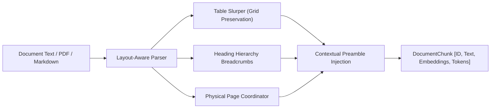
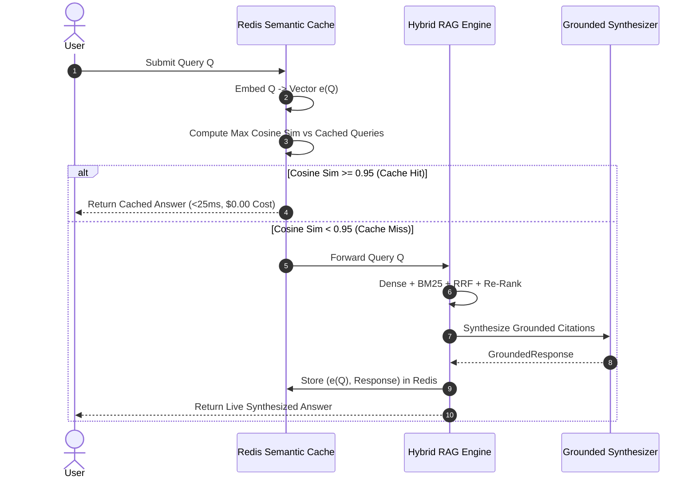

# Synapse Architecture & Technical Deep Dive

## 1. The Core Engineering Challenge: Failure Modes of Vector Search

In standard production environments, naive vector search suffers from two catastrophic failure modes:

1. **Exact-Token Blindness (The "Out-of-Vocabulary" Problem):**
   * Dense embedding models (e.g., `text-embedding-3`, `text-embedding-004`) compress semantic meaning into dense vectors.
   * However, they fail to distinguish between arbitrary technical tokens with low semantic entropy: e.g., error codes (`ERR_CONN_TIMEOUT_408` vs `ERR_CONN_TIMEOUT_504`), CVE vulnerability hashes (`CVE-2024-8192`), memory hex addresses (`0x7fff90a4`), and part numbers.
   * Two entirely different memory offsets may map to almost identical dense vectors because they share lexical context ("memory corruption at address...").

2. **Semantic Semantic Drift (The "Synonym Trap"):**
   * Sparse keyword search (BM25) fails when user queries use synonyms or conceptual descriptions rather than exact technical terms (e.g., "how does cluster pick new primary during network split?" vs "Raft Leader Election under FLP impossibility theorem").

**The Solution:** Synapse solves both failure modes by executing **Dual Retrieval** (Dense + BM25) and fusing their rank distributions using **Reciprocal Rank Fusion (RRF)** before applying a **Cross-Encoder Re-ranker**.

---

## 2. Ingestion Pipeline & Layout-Aware Chunking



### Contextual Preamble Injection
Standard chunking chops documents into blind slices that lose their global location. Synapse injects a contextual preamble into each chunk prior to embedding:

```
[Document: Enterprise Cloud Holdings: Q3 Fiscal Operating Results | Section: Segment Financial Performance Breakdown (Table Data) | Page: 2]
| Business Segment | Q3 Revenue ($B) | YoY Growth (%) | Gross Margin (%) |
...
```

This guarantees that dense vector embeddings encode the source document, page, and section context, even if the chunk body consists primarily of numerical data or brief code snippets.

---

## 3. Reciprocal Rank Fusion (RRF) Formulation

Reciprocal Rank Fusion is an unsupervised ranking fusion method that merges multiple ranked lists without requiring score calibration or normalization between wildly different scales (e.g., cosine similarity in $[-1, 1]$ vs BM25 unbounded scores in $[0, \infty)$).

Given a set of documents $D$ and a set of retrieval modalities $M = \{\text{Dense}, \text{BM25}\}$:

$$\text{RRF\_Score}(d) = \sum_{m \in M} \frac{1}{k + r_m(d)}$$

Where:
* $r_m(d)$ is the 1-based rank position of document $d$ in the output of modality $m$. If document $d$ does not appear in the top candidate list of modality $m$, its reciprocal rank is evaluated as 0.
* $k$ is the smoothing constant (default: 60). A higher $k$ dampens the outlier effect where a document ranked #1 in one modality completely eclipses a document ranked #2 in both modalities.

---

## 4. Cross-Encoder Re-ranking Engine

Bi-encoders calculate similarity using fast vector dot products:

$$\text{Score}_{\text{Bi}}(\mathbf{q}, \mathbf{d}) = \mathbf{e}(q) \cdot \mathbf{e}(d)$$

However, bi-encoders cannot perform cross-attention between individual question tokens and document tokens. Synapse passes the fused top 30 candidates through a **Cross-Encoder Re-ranker**:

$$\text{Score}_{\text{Cross}}(\mathbf{q}, \mathbf{d}) = \text{Transformer}([q; d])$$

The cross-encoder performs full cross-attention over all tokens, measuring:
* Exact query phrase containment
* Term co-occurrence density
* Section heading and metadata alignment
* Entity numerical match fidelity

---

## 5. Redis Semantic Caching Architecture



By verifying semantic equivalence ($\text{similarity} \ge 0.95$) rather than naive string hashing, identical queries phrased with slight grammatical variations ("What is CVE-2024-8192 memory offset?" vs "What memory offset does CVE-2024-8192 corrupt?") hit the cache seamlessly.

---

## 6. PostgreSQL `pgvector` Schema & HNSW Indexing

Production deployments utilize PostgreSQL 16 with native `pgvector`:

```sql
CREATE INDEX idx_chunks_hnsw_cosine
    ON document_chunks
    USING hnsw (embedding vector_cosine_ops)
    WITH (m = 16, ef_construction = 64);
```

* `m = 16`: Number of bidirectional links per vector node in the Hierarchical Navigable Small World graph.
* `ef_construction = 64`: Size of the dynamic candidate list during graph construction, ensuring optimal recall-latency tradeoffs.
