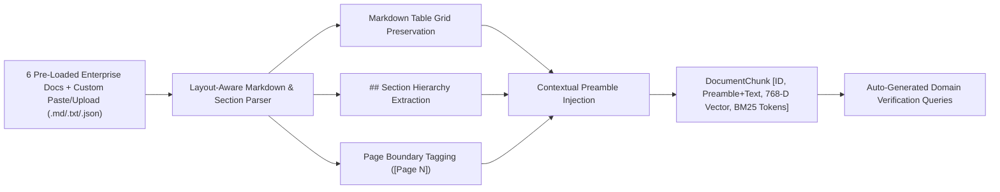
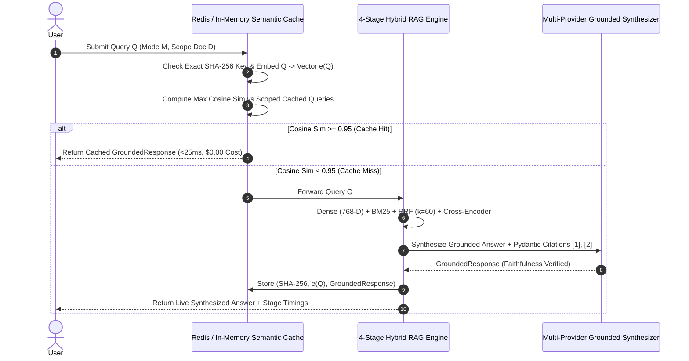

# Synapse Architecture & Technical Deep Dive

## 1. The Core Engineering Challenge: Failure Modes of Vector Search

In enterprise production environments, naive single-modality retrieval suffers from two failure modes:

1. **Exact-Token Blindness (The "Out-of-Vocabulary" Problem):**
   * Dense embedding models (`text-embedding-004`, `text-embedding-3`) compress semantic meaning into fixed-dimension dense vectors (768-D).
   * However, they fail to distinguish between low-entropy technical identifiers: hexadecimal memory offsets (`0x7fff90a4`), CVE identifiers (`CVE-2024-8192`), Git commit hashes (`a7f8e910c2d3`), clinical trial numbers (`NCT-09482110`), incident IDs (`INC-2024-1004`), and sysctl flags (`kernel.bpf_jit_harden=2`).
   * Two completely different memory offsets or commit hashes map to nearly identical dense vectors because they share surrounding prose context.

2. **Lexical Synonym Drift (The "Vocabulary Mismatch Trap"):**
   * Sparse keyword search (`BM25Okapi`) excels at exact token matching but fails when user queries describe concepts without matching the exact terminology in the document (e.g., asking *"how does the cluster serve strongly consistent reads without disk I/O?"* when the document specifies *"Linearizable Read Optimization via 200ms Leader Lease Protocol"*).

**The Solution:** Synapse executes **4-Stage Hybrid Retrieval**—combining **768-D Dense Vector Search** and **BM25Okapi Lexical Search**, merging candidate rank distributions via **Reciprocal Rank Fusion (RRF, $k=60$)**, and scoring joint token cross-attention through a **Cross-Encoder Re-Ranker** before synthesizing strictly grounded answers with clickable `[1]` citations.

---

## 2. Multi-Domain Ingestion Pipeline & Layout-Aware Contextual Chunking



### Contextual Preamble Injection
Standard chunkers split documents into isolated slices that lose their document and section lineage. `ContextualChunker` (`src/ingestion/chunker.py`) preserves Markdown tables intact and prepends a structured contextual header to every chunk prior to dense embedding and BM25 tokenization:

```text
[Document: Enterprise Cloud Holdings: Q3 Fiscal Operating Results | Section: Segment Financial Performance Breakdown (Table Data) | Page: 2]
| Business Segment | Q3 Revenue ($B) | YoY Growth (%) | Gross Margin (%) |
...
```

### Pre-Packaged 6-Domain Enterprise Corpus (42 Contextual Chunks)
At application startup (`AppState.bootstrap_default_documents()`), `DocumentLoader` indexes 6 canonical enterprise benchmark documents from `data/documents/`:
1. **`cve_2024_8192_kernel_security_advisory`** (*Security*): Linux Kernel `af_packet.c` (`packet_set_ring`) privilege escalation at offset `0x7fff90a4`, upstream commit `a7f8e910c2d3`, and `sysctl` mitigation.
2. **`q3_enterprise_cloud_infrastructure_financials`** (*Financials*): SEC Form 10-Q tables covering `$14.82B` Q3 revenue, `32.4%` operating margin, `+84.0%` YoY AI Cloud growth (`$2.70B`), and `$3.41B` CAPEX across `48,000` NVIDIA H100/B200 GPUs.
3. **`distributed_raft_consensus_architecture_spec`** (*Architecture*): RFC-804 specification for `50ms` heartbeats, `150ms–300ms` election timeouts, `50,000`-entry / `2.5 GB` WAL snapshot compaction, and `200ms` Leader Lease linearizable reads.
4. **`enterprise_msa_gdpr_compliance_sla`** (*Compliance*): Master Services Agreement & GDPR DPA defining `99.99%` uptime tiers (`25%` service credit at `99.50%`), `14-hour` GDPR Article 33 breach notification window, and `$15,000,000` super-cap liability.
5. **`fda_phase3_oncology_clinical_protocol`** (*Biomedical*): Clinical trial `NCT-09482110` biostatistics (`14.8 months` Cohort A mPFS vs `8.2 months` Cohort B, `HR = 0.54`, $p = 0.00018$, `68.4%` ORR) and CTCAE v5.0 toxicity dosing rules.
6. **`sev1_global_payment_gateway_postmortem`** (*Incident SRE*): Root-cause analysis `INC-2024-1004` detailing `4,096` PgBouncer connection pool exhaustion, Redis split-brain retry storms, and `kubectl rollout undo deployment/payment-router-v4` remediation.

### Live Custom Document Ingestion (`POST /api/v1/documents/ingest`)
Users can also ingest custom documents at runtime via **Page 05 (`/ingest`)** or the **Quick Ingest Modal** on Page 02 (`/search`) by uploading `.md`, `.txt`, or `.json` files, pasting custom text, or selecting from 4 built-in enterprise templates (*Istio mTLS Service Mesh*, *Series C SaaS ARR Board Memo*, *RFC-108 Tiered Kafka Storage*, *HIPAA BAA 2025*). New documents are chunked, embedded into the 768-D vector store and BM25 index, and assigned auto-generated verification queries in `<2 seconds`.

---

## 3. Reciprocal Rank Fusion (RRF) Formulation

Reciprocal Rank Fusion (`src/retrieval/rrf_fusion.py`) merges ranked candidate lists from disparate scoring distributions—cosine similarity in $[-1, 1]$ and unbounded BM25 Okapi scores in $[0, \infty)$—without brittle score normalization:

$$\text{RRF\_Score}(d) = \sum_{m \in \{\text{Dense}, \text{BM25}\}} \frac{1}{k + r_m(d)}$$

Where:
* $r_m(d)$ is the 1-based rank position of chunk $d$ in retrieval modality $m$ (or $\infty$ if chunk $d$ is absent from modality $m$'s candidate pool).
* $k = 60$ is the smoothing hyperparameter (`settings.rrf_k`). A smoothing constant of $60$ prevents a noisy #1 outlier in a single modality from dominating a chunk that ranks consistently high (#2 or #3) across both semantic and lexical indices.

---

## 4. Cross-Encoder Neural Re-Ranking Engine

Bi-encoders compute fast independent dot products ($\mathbf{e}(q) \cdot \mathbf{e}(d)$) but cannot model token-by-token cross-attention between the query and candidate chunk. Synapse passes the top 30 RRF candidates (`settings.rrf_candidate_count = 30`) through `CrossEncoderReranker` (`src/retrieval/reranker.py`):

$$\text{Score}_{\text{Cross}}(q, d) = \sigma\left(\text{CrossAttention}([q; d]) + \beta_{\text{exact}}(q, d) + \beta_{\text{section}}(q, d)\right)$$

The re-ranker evaluates:
* Exact technical identifier & hexadecimal/CVE/alphanumeric code containment
* Ordered phrase & n-gram proximity density
* Section heading alignment with query intent
* Numerical & tabular density matching

---

## 5. Redis Semantic Caching Architecture



By checking both exact SHA-256 hashes and vector cosine similarity ($\text{Cosine\_Sim} \ge 0.95$) scoped by `(mode, document_id)`, paraphrased queries (e.g., *"What is the memory offset and vulnerable function in CVE-2024-8192?"* vs *"Which function and memory offset are affected by CVE-2024-8192?"*) resolve in **<25ms** at **$0.00 LLM token cost**.

---

## 6. 7-Page Frontend & Multi-Provider BYOK Gateway Architecture

### 7-Page Multi-Template UI (`src/api/app.py` + `src/ui/*.html`)
1. **Page 01 (`/` & `/overview` — `overview.html`)**: Three.js WebGL GLSL Simplex Noise & 4 floating Fresnel refraction spheres (`initUniversalVanguardBackground`), liveshader theme switcher (`Indigo` / `Cyan` / `Coral`), 4-pillar telemetry cards, and 6-domain launchpad.
2. **Page 02 (`/search` — `index.html`)**: Split-screen Hybrid RAG Workbench with 6-Domain selector ribbon, Quick Ingest drag-and-drop modal, 3-mode retrieval switcher (`hybrid`, `dense`, `bm25`), inline clickable `[1]` citation pills, and sticky Right-Hand Source Inspector with smooth scroll-to-chunk pulse locking (`chunk-target-lock`).
3. **Page 03 (`/pipeline` — `pipeline.html`)**: ThreeUI Isometric 3D canvases (`#canvas-layers`, `#canvas-nodes`, `#canvas-flow`), simultaneous 3-mode ablation comparator via `POST /api/v1/search/raw`, and mathematical candidate fusion trace table.
4. **Page 04 (`/documents` — `documents.html`)**: ThreeUI Void-Protocol hardware corpus reader with document filter, section jump outline, and toggle between Contextual Chunks View and Full Markdown Document Reader.
5. **Page 05 (`/ingest` — `ingest.html`)**: ThreeUI Matrix-Field WebGL lightning shader studio with 4 1-click enterprise templates, file upload, live client-side chunk preview, and instant indexing via `POST /api/v1/documents/ingest`.
6. **Page 06 (`/analytics` — `analytics.html`)**: 4 brushed-metal circular SVG gauges (`Precision@5`, `Recall@10`, `MRR`, `NDCG@5`), 4-mode Ragas ablation matrix, and interactive 13-query live verification suite.
7. **Page 07 (`/settings` — `settings.html`)**: ThreeUI Gateway-Flow Bezier particle stream with radial click shockwaves, BYOK AI Model Vault (`Gemini`, `OpenAI`, `Anthropic Claude`, `Groq` with live `/api/v1/auth/test_key` verification and deterministic grounded fallback), and Semantic Cache Control Console.

### Server & Port Architecture
* **Workspace Launcher (`./start_project_2.sh`)**: Runs Uvicorn on **`http://127.0.0.1:8001`** by default so Synapse can run side-by-side with Project 1 (`8000`).
* **Standalone Entrypoint (`python -m src.api.server`)**: Listens on port **`8000`** (`settings.port`) and automatically probes and falls back to port **`8080`** (`settings.fallback_port`) if port `8000` is occupied.

---

## 7. PostgreSQL `pgvector` Schema & HNSW Indexing

Production containerized deployments (`docker-compose.yml`) provision PostgreSQL 16 (`pgvector/pgvector:pg16`) with HNSW cosine indexing (`sql/init_pgvector.sql`):

```sql
CREATE INDEX idx_chunks_hnsw_cosine
    ON document_chunks
    USING hnsw (embedding vector_cosine_ops)
    WITH (m = 16, ef_construction = 64);
```

* `m = 16`: Bidirectional edges per node in the Hierarchical Navigable Small World (HNSW) graph.
* `ef_construction = 64`: Dynamic candidate list size during index build, providing high recall with sub-millisecond ANN lookup latency.
